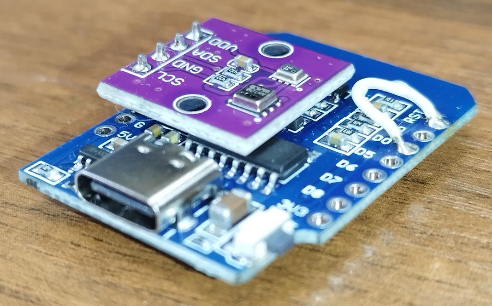
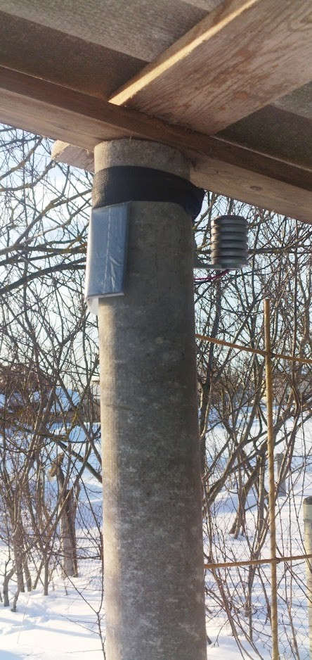

# MeteoStationESP8266
Автономная уличная WIFI метеостанция на базе ESP8266 с питанием от солнечной панели через MPPT контроллер и суперконденсатор. В состав метеостанции входит плата WemosD1mini с метеодатчиками. Идея конструктива метеостанции подсмотрена здесь: https://github.com/ghmartin77/ESP8266_BME280. В программе использованы идеи различных авторов, найденные на просторах интернета. Код написан в среде Arduino IDE v.1.8.13. Актуальная версия кода прошла ревью при помощи ИИ.

Электрическая схема метеостанции:  

Программа автоматически определяет наличие и статус метеодатчиков, считывает и отсылает полученную от них информацию на сервер narodmon.ru, и засыпает до следующего сеанса. При первом запуске или отсутствии сети кратковременно создается точка доступа по адресу 192.168.4.1 для возможности настройки WIFI через WEB-интерфейс. После настройки на сервер народного мониторинга будут отправляться собранные данные, а в виртуальный последовательный порт будет выводиться отладочная информация. Питание метеостанции осуществляется от солнечной панели через MPPT контроллер и литий-ионнный суперконденсатор. Допустимое напряжение для литий-ионнного суперконденсатора обычно составляет от +2.5 до +4.2В. Выход за границы допустимого напряжения приведёт к деградации литий-ионнного суперконденсатора. Для продолжительной автономной работы метеостанции особое внимание в коде уделено экономии электроэнергии. Заряда суперконденсатора хватает на круглосуточную работу метеостанции с периодичностью активации ~15-20мин. В пасмурную погоду и при морозах в московском регионе проблем в работе метеостанции не наблюдалось. Метеостанция умеет работать с разными типами датчиков, подключенных к шинам I2C и 1Wire: BME(P)180/280, AHT20, DS18B20. В коде датчики описаны в определениях. Для датчика DS18B20 требуется наличие внешнего подтягивающего резистора 4.7 кОм между линией данных и питанием датчика. Для снижения риска выхода из строя метеодатчиков по причине электрохимической коррозии и как следствие, продления типового срока службы датчиков, предприняты меры:
 - датчики программно обесточены и лишь кратковременно запитываются только в момент их опроса;
 - электронные компоненты метеостанции за исключением отверстий чувствительных элементов метеодатчиков покрыты лаком PLASTIK-71.

Показания датчиков и статистику в графическом виде можно наблюдать по ссылке на страницу метеостанции: https://narodmon.ru/D12701#

Корпусные детали для метеостанции: https://r2akt.ru/%d0%bf%d1%80%d0%be%d0%b5%d0%ba%d1%82%d1%8b/%d0%bc%d0%b5%d1%82%d0%b5%d0%be%d0%be%d1%81%d1%82%d0%b0%d0%bd%d1%86%d0%b8%d1%8f
